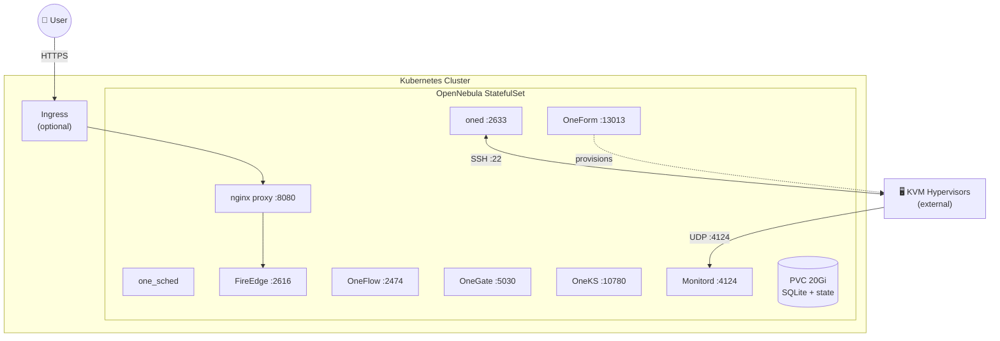

<div align="center">

# OpenNebula Helm Chart

A Helm chart and container image for running an **OpenNebula front-end** on Kubernetes.

[](https://helm.sh)
[](https://opennebula.io)
[](https://hub.docker.com/r/opennebula/opennebula)

</div>

> **Community-maintained. Not an official OpenNebula Systems product.**
> This project is maintained by the community on a best-effort basis. Issues and
> fixes are handled by community contributors, not by OpenNebula Systems. Do not
> open support tickets for it. For a supported deployment, follow the official
> documentation at [docs.opennebula.io](https://docs.opennebula.io).

## What this is

A containerized **OpenNebula front-end**: the control plane only. Virtual machines
run on external hypervisor nodes that you attach to it.

- **Front-end only, by construction.** There is no `libvirt` and no `qemu` inside
  the image, and no host is registered at startup. VMs cannot run in this
  container, which keeps the control plane small and predictable.
- **SQLite by default.** Exactly like a stock OpenNebula front-end. No external
  database is required and nothing else has to be deployed first.
- **Batteries included.** Ships **OneForm** (`oneprovision`, `oneprovider`) to
  provision remote hosts, and **OneKS** to deploy Kubernetes clusters on them.
- **Readable logs.** Every service writes to the container's stdout, so
  `kubectl logs` shows real errors, including `oned`'s own log. No shell access
  into the pod is needed to diagnose a failure.

## Quick start

```bash
helm repo add opennebula https://pablodelarco.github.io/opennebula-helm
helm repo update
helm install opennebula opennebula/opennebula
```

That is the whole installation. No database, no secrets, no values file.

Access the UI:

```bash
kubectl port-forward svc/opennebula 8080:2616
```

Then open http://localhost:8080/fireedge and log in as `oneadmin`. The default
password is `opennebula`; override it with `--set opennebula.adminPassword=...`.

### Docker, without Kubernetes

```bash
docker run -d --name opennebula \
  -p 2616:2616 -p 2633:2633 \
  -v one-data:/var/lib/one \
  opennebula/opennebula:7.4.0
```

## Architecture



Two Services are created. The regular ClusterIP is for clients (UI, OneFlow,
OneGate). The **headless** Service gives the pod a stable DNS name, which is the
address advertised to hypervisors so they always find the front-end at the same
place even after a restart.

## Configuration

| Value | Default | Description |
|---|---|---|
| `image.repository` | `opennebula/opennebula` | Image repository |
| `image.tag` | `""` | Defaults to the chart's `appVersion` |
| `opennebula.adminPassword` | `opennebula` | Password for `oneadmin` |
| `opennebula.hostname` | `""` | Address advertised to hypervisors. Defaults to the StatefulSet FQDN |
| `opennebula.monitorAddress` | `""` | Where hypervisors send monitoring data |
| `persistence.enabled` | `true` | Persist `/var/lib/one` |
| `persistence.size` | `20Gi` | Volume size |
| `resources` | 1Gi / 250m requests | Measured idle usage is ~500 MiB and ~15m CPU |
| `ingress.enabled` | `false` | Expose FireEdge through an Ingress |

Container environment variables are documented in
[`docker/README.md`](docker/README.md), including `DB_BACKEND` (set it to
`mysql` if you prefer an external database) and `AUTO_UPDATE_ADDONS`.

## Adding hypervisor hosts

OpenNebula manages VMs on external hosts over SSH.

**1. Get the front-end's public key**

```bash
kubectl exec opennebula-0 -c opennebula -- cat /var/lib/one/.ssh/id_rsa.pub
```

**2. Prepare the hypervisor** (Ubuntu 24.04)

```bash
sudo useradd -m -d /var/lib/one -s /bin/bash oneadmin
sudo install -d -m 700 -o oneadmin -g oneadmin /var/lib/one/.ssh
echo "PASTE_KEY_FROM_STEP_1" | sudo tee /var/lib/one/.ssh/authorized_keys
sudo chmod 600 /var/lib/one/.ssh/authorized_keys
sudo chown -R oneadmin:oneadmin /var/lib/one

# Node packages must match the front-end version (the chart's appVersion)
wget -q -O- https://downloads.opennebula.io/repo/repo2.key | sudo apt-key add -
echo "deb https://downloads.opennebula.io/repo/7.4/Ubuntu/24.04 stable opennebula" \
  | sudo tee /etc/apt/sources.list.d/opennebula.list
sudo apt update && sudo apt install -y opennebula-node-kvm
sudo usermod -aG libvirt,kvm oneadmin
```

**3. Register it**

```bash
kubectl exec opennebula-0 -c opennebula -- onehost create <ip> -i kvm -v kvm
kubectl exec opennebula-0 -c opennebula -- onehost list
```

The host should reach `on`. If it stays in `err`, the front-end name must be
resolvable from the node and vice versa.

### Automatic provisioning with OneForm

OneForm is installed in the image, so hosts can be provisioned instead of
prepared by hand:

```bash
kubectl exec opennebula-0 -c opennebula -- oneprovider list
kubectl exec opennebula-0 -c opennebula -- oneprovision create provision.yml
```

See the [OneForm documentation](https://docs.opennebula.io/7.4/product/cluster_provisioning/)
for the provider and provision file formats. Kubernetes clusters can then be
deployed on those hosts with `oneks`.

## Troubleshooting

All services log to the container's stdout, so this is usually enough:

```bash
kubectl logs opennebula-0 -c opennebula
```

`oned`'s own log is included, so start-up failures state their cause directly.
For example, an unreachable database prints:

```
FATAL: cannot reach MySQL at <host>:<port> after 120s
FATAL: check DB_HOST, DB_PORT, credentials, DNS and network policy
```

Check which services are up:

```bash
kubectl exec opennebula-0 -c opennebula -- supervisorctl status
```

Expect six: `oned`, `fireedge`, `oneflow`, `onegate`, `oneform-server` and
`oneks-server`.

## Contributing

Issues and pull requests are welcome at
[github.com/pablodelarco/opennebula-helm](https://github.com/pablodelarco/opennebula-helm).

## License

Apache 2.0
